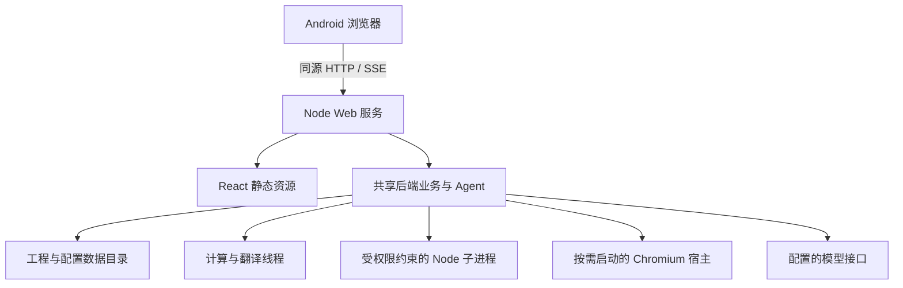

# Termux 后端与 Web 前端完整修改方案

规划建立日期：2026-10-17。执行进度只记录在 [HANDOFF](../HANDOFF.md)，实施方法见 [操作标准](TERMUX_WEB_OPERATIONS.md)。本文描述目标与任务，不声明目标已经实现。

## 1. 目标与范围

将现有应用改造为单用户本地 Web 应用：Termux 原生 Node.js 运行后端，Android 浏览器访问同一个服务提供的 React 页面、HTTP API 与 SSE。复用现有翻译、校对、工程、模型和产品 Agent 能力。

完整交付包含：

- 无需 Electron、桌面环境或开发服务器即可启动和使用 Web 版本。
- 工程库、文件上传、受限目录访问、工程保存及译文下载。
- TXT、字幕、EPUB 等核心流程，以及现有其余格式的兼容验证。
- 模型配置、术语表、提示词、文本规则、校对、日志和设置。
- 文本 Agent、工作区执行、审批与恢复，以及按需提供的图片和 PDF 宿主。
- 手机触屏操作、页面重连、后端退出与重启恢复。
- 可复现的安装、构建、运行、更新和备份方法。

核心可用版是中间里程碑；图片、PDF、复杂格式和发布任务完成前，不宣称完整改造完成。可选组件未安装时，产品应准确说明能力不可用。

本次不包含多用户、远程公开服务、原生 Android APK、手机本地模型推理引擎、PWA 离线执行或新格式开发。现有模型可继续指向用户配置的在线或本机接口。新增这些目标须明确调整范围。

以 Termux 为首个目标环境，平台差异集中在入口和宿主能力；业务层不散布 Android 分支。不新建桌面兼容框架，不将维护全部桌面发行平台作为本次交付条件；迁移中保留仍被共享能力依赖的代码，清理失去调用者的桌面代码前核对依赖与测试。

## 2. 当前实现入口与改造落点

下表是规划时的源码基线，实施时重新核对。环境实测和依赖验证结果见 `HANDOFF.md`。

|当前入口|当前责任|改造方向|
|---|---|---|
|[产品入口](../src/index.ts)、[GUI 入口](../src/gui/gui-entry.ts)|分发 GUI / CLI，配置桌面资源|增加独立 Web 启动入口，资源路径显式注入|
|[完整后端装配](../src/backend/bootstrap/gui-backend-bootstrap.ts)|装配业务、Agent、Gateway 和宿主端口|抽出宿主无关的完整组合根，保持生命周期唯一|
|[基础资源](../src/backend/bootstrap/backend-resources.ts)、[业务服务](../src/backend/bootstrap/backend-services.ts)|设置、数据库、网络与业务服务|复用；核对数据根、代理与资源释放|
|[Gateway](../src/backend/api/api-gateway-server.ts)、[路由](../src/backend/api/api-routes.ts)|本机 API 与 SSE|加入同源静态资源、访问验证、Web 文件交互|
|[前端传输](../src/frontend/app/desktop/desktop-api.ts)、[宿主接口](../src/gui/bridge/bridge-api.ts)|消费 `window.desktopApp`|改为显式 Web 启动配置和能力信息|
|[工程写入口](../src/backend/project/project-write-store.ts)、[生命周期](../src/backend/project/project-lifecycle-service.ts)|工程一致性与会话|复用写入语义，接入工程库与导入材料|
|[路径服务](../src/backend/app/app-path-service.ts)|安装、资源和数据路径|分离安装根、只读资源根与可写数据根|
|[Agent 运行器](../src/backend/agent/workspace/runtime/runner.ts)|子进程、权限与 IPC|采用 Termux Node，保留授权和取消边界|
|[图片宿主](../src/native/agent-image-host.ts)、[PDF 宿主](../src/native/pdf-host.ts)|Electron 隐藏窗口执行图像和打印|实现按需启动的 Chromium 宿主|
|[Vite 配置](../buildtools/vite/electron.vite.config.ts)、[工作区构建](../buildtools/build-workspace.mjs)|桌面构建与工作区部署|独立 Web 构建，部署 Android 可用的运行依赖|

## 3. 目标架构与责任边界

### 3.1 运行入口与生命周期

- 一个对用户可见的服务地址提供页面、API 和 SSE，默认绑定 `127.0.0.1`。支持显式端口配置，端口占用应可诊断，实际地址由启动结果提供。
- Web 组合根拥有后端生命周期，计算线程继续承担重型计算。是否复用现有 Backend Runtime worker，由 `TW-02` 的启动和阻塞验证决定，不为移除 Electron 合并全部计算到 HTTP 事件循环。
- 安装根、内置资源、工作区运行目录和数据根使用绝对路径注入，改变工作目录不能改变数据落点。
- 后端就绪后才宣布服务可用。启动失败清理已创建资源，`SIGINT` / `SIGTERM` 停止受理并按依赖逆序释放。
- 页面离开不等于服务停止。显式关闭服务由终端或已鉴权的操作发起，不绑定 `beforeunload`。

### 3.2 状态、任务与恢复

|状态|拥有者|生命周期|
|---|---|---|
|工程资产、译文、修订与对话事实|既有数据库及写入口|跨重启持久化|
|当前工程、任务占用与活动请求|后端运行态|后端进程生命周期|
|工程目录索引与导入/导出材料|后端文件服务|按各自提交与清理规则|
|页面筛选、导航和编辑草稿|现有前端状态层|按当前工程和页面寿命|
|访问会话与启动能力信息|Web 服务|独立于业务工程生命周期|

- 一个服务实例只有一个共享工程会话。多个标签页共享当前工程和任务，切换工程通过现有互斥与修订机制协调，不按标签页偷偷创建第二套后端。
- 上传、预览等请求允许随连接取消；已受理的翻译、Agent 等后台任务拥有独立生命周期。复用现有命令身份与状态查询，补齐受理回包丢失后的重复提交处理。
- SSE 重连后读取快照与修订，处理服务重启后的会话失效、旧事件和迟到响应。
- 后端崩溃后以持久化事实恢复，未完成运行显示为中断。首版不自动重放可能产生费用或副作用的操作；提供用户主动继续或重试的自然入口。
- 不承诺 Android 永不终止服务。阶段验收分别覆盖页面断线、正常停止和异常终止。

### 3.3 访问边界与网络

- 静态资源与 API 同源；开发时使用受控代理。移除 Web 入口的任意来源 CORS，校验 `Host` 与 `Origin`，覆盖预检、SSE 和下载。
- 建立本机启动到浏览器的访问会话。优先验证一次性启动凭据换取会话 Cookie 的方案；凭据不进入普通日志、长期 URL 或持久浏览器存储。实现时明确 Cookie 属性、有效期、重启失效和启动凭据清理。
- 写接口增加相应跨站请求防护；会话校验不能仅依赖 CORS。未授权请求不得读取配置、下载文件或触发 Agent。
- 页面配置只包含必要的版本、地址和能力信息，不含模型密钥。用户设置中的凭据保持既有保管语义并核对响应和日志脱敏。
- Node 网络使用明确的直连或代理配置，保留回环直连和失败反馈，不因移除 Electron 静默改变网络路线。核对模型认证、回调与外链流程。

### 3.4 工程库与文件交互

- 默认数据放在 Termux 私有目录。安装更新不能覆盖用户数据；共享存储仅作为用户选择的导入、导出位置。
- 工程库采用已有目录和元信息能力组织。工程事实仍由 `.lg` 和既有服务持有；如需索引，只存发现与展示所需信息，并能修复失效条目。
- 浏览器上传先进入后端管理的临时材料，完成校验后交由现有导入服务；源文件名与相对目录属于元数据，不作为可信绝对路径。
- 后端目录浏览限制在配置的允许根内；核对路径归一、真实路径、符号链接和实际打开边界。不能把通用文件系统访问权暴露给所有 API 请求。
- 单文件、多文件、重名、目录结构、取消、空间不足和部分失败使用明确协议。流式接收设大小、数量和临时目录限额，清理只覆盖服务拥有的材料。
- 游戏目录优先经后端目录选择接入；打包上传须保留相对结构并验证解包边界、体积和失败回滚。
- 译文、术语表、提示词和工程副本通过受控下载交付。工程副本在数据库一致性边界生成，不能直接复制正在写入的文件。
- Agent 附件上传与工程原稿导入拥有不同生命周期，可复用底层传输能力，不能混用材料所有权。

### 3.5 前端与宿主能力

- 移除 Web 启动对 `window.desktopApp` 的必需依赖，迁移所有消费点；不通过空函数模拟文件保存或任务成功。
- 使用显式能力信息决定文件、图片、PDF、系统通知等入口。服务端仍校验能力，不只隐藏按钮。
- 日志改为网页入口，外链使用浏览器行为，桌面更新入口改为适合本地服务的版本与更新说明。
- 手机优先采用抽屉导航、单栏设置、可触达的表格编辑与替代右键菜单；拖拽操作提供触屏路径。
- 保持现有设计语言、文案体系和主题。核对动态视口、安全区、软键盘、长文输入、弹窗、虚拟列表及滚动恢复。
- 图片和 PDF 由后端宿主执行，不依赖某个前端标签页存活。Chromium 按需启动并限制并发，使用独立浏览器配置，超时和取消需等待资源释放。

## 4. 任务分解与验收

任务 ID 固定用于 `HANDOFF.md`、验证记录和交接。任务内可按依赖完成子项；未通过验收不登记为完成。

### TW-00：建立执行材料

- 产出本方案、`HANDOFF.md`、操作标准和 `AGENTS.md` 执行入口。
- 验收：职责分离、链接有效、计划与当前事实明确、进度不虚报。

### TW-01：依赖与运行环境验证

- 依赖：`TW-00`。
- 检查 `package.json` 与锁文件，拆分 Web 安装路径与 Electron 安装副作用，区分开发工具、运行依赖和可选宿主依赖。
- 实际验证 TypeScript 平台工具、Vite / Rolldown、Tailwind、`oxc-parser`、`mupdf`、`@ruby/prism`、模型 SDK 与数据库。锁文件存在平台包只作为线索。
- Android ARM64 缺少 TypeScript 预编译包时，从与锁定依赖一致的官方源码构建本机编译器，仅补平台支持并校验源码完整性；首次准备需要 Go，开发编译器不进入 Web 运行产物。
- 提供受约束 Node 子进程与工作区依赖的最小运行验证。若本机完整构建受阻，明确可复现的外部构建加 Android 运行依赖部署方案；不能以绕过类型检查代替完成验证。
- 验收：记录真实安装、模块加载和类型检查结果；确定可复现的 Web 工具链与运行路径，不要求安装 Electron 才能使用核心功能。

### TW-02：Web 服务与后端组合根

- 依赖：`TW-01`。
- 新增独立 Node 入口与 Web 构建，提取宿主无关的完整后端装配；复用 `BackendResources`、`BackendServices`、Agent 和现有 Gateway。
- 改造路径注入，部署版本、内置资源、计算 worker 与工作区；提供明确的数据根和端口参数。
- 核对正常关闭、启动中关闭、重复停止、异常退出、端口冲突和同一数据根重复启动；复用现有锁能力，缺口再补。
- 验收：在仓库外启动构建产物，健康状态、资源定位及停止有效；无 Electron 运行依赖，重型计算不破坏服务响应。

### TW-03：同源服务与访问会话

- 依赖：`TW-02`。
- 提供静态资源、页面刷新回退、启动能力信息和会话建立；API 路径不得误回退为 HTML。
- 完成鉴权、`Host` / `Origin`、跨站请求、下载和 SSE 边界，明确开发代理规则。
- 接入 Node 代理设置及模型认证涉及的回调/外链行为。
- 验收：合法会话访问成功；未授权、错误来源、错误 Host、会话失效及越界文件请求被拒绝；日志和页面配置无凭据泄漏。

### TW-04：浏览器前端启动与桌面能力迁移

- 依赖：`TW-03`。
- 将 Web 配置与能力注入前端传输、壳层和页面，逐一迁移 `window.desktopApp` 消费点。
- 改造标题栏、日志、外链、通知、服务状态和更新入口；保留统一错误反馈、快照与事件恢复。
- 验收：普通浏览器在没有 preload 的环境中完成启动、设置读取、模型管理和日志查询；深层页面刷新正常；未支持功能不伪装成功。

### TW-05：工程库、文件导入与下载

- 依赖：`TW-03`、`TW-04`。
- 实现工程列表、新建、打开、关闭、追加导入、后端受限目录选择、工程副本与译文下载。
- 迁移术语表、提示词、规则导入导出和固定目录设置，覆盖上传与下载生命周期。
- 保留现有 `.lg` 数据、事务、修订与迁移流程；通过独立副本验证旧工程打开，不自动搬移用户原件。
- 验收：用合成 TXT、字幕、EPUB 完成导入到导出闭环，校对修改和重开可恢复；重复、重名、失败、取消、下载一致性与路径边界有证据。

### TW-06：后台任务、重连与中断恢复

- 依赖：`TW-05`。
- 将后台任务受理与 HTTP 连接寿命分开，复用运行互斥，补齐受理回包丢失的查询和去重。
- 验证多标签页同步、工程切换、页面重载、SSE 重连、服务重启和未保存草稿反馈。
- 区分已提交结果与运行内存；异常退出后标记中断并允许主动继续，不无条件重放 Agent 副作用。
- 验收：关闭全部页面后任务继续；重连读取正确快照；正常停止能收尾；强制终止后数据库可重开，已提交结果保留，未完成状态准确。

### TW-07：文本 Agent 与工作区

- 依赖：`TW-05`、`TW-06`；环境探针在 `TW-01` 提前完成。
- 用 Termux Node 启动正式工作区，保留权限参数、模块钩子、IPC、取消、审批与文件写入边界。
- 将保存路径/打开目录等宿主请求接入 Web 文件流程，浏览器暂时不在线时有明确的等待或后续领取语义。
- 按实际能力更新模型可见说明和运行时资源；管理技能与加载回退按机制验证。
- 验收：使用合成工作区和本机模型模拟服务完成对话、材料上传、受限脚本执行、工程写入审批、取消与重连；覆盖禁止路径和父进程退出。

### TW-08：手机界面与交互

- 依赖：`TW-04`；工程和 Agent 页面分别在 `TW-05`、`TW-07` 后验收。
- 逐页处理项目、工作台、模型、Agent、校对、术语、规则、提示词、技能、日志与设置，登记覆盖矩阵。
- 优先触屏导航、文件选择、输入、编辑、下载和错误恢复，再调整复杂表格和辅助页面。
- 验收：`390 × 844`、`844 × 390` 和 `1280 × 900` 浏览器视口截图实际查看；Android 浏览器验证软键盘、文件选择、下载和后台返回。页面无意外整体横向溢出，表格必要横向滚动局限在自身容器，主要操作不依赖悬停或右键。

### TW-09：图片与 PDF 宿主

- 依赖：`TW-02`、`TW-07`，相关界面随 `TW-08` 验收。
- 用可配置的本机 Chromium 实现 `AgentImageHost` 与 `PDFHost`；基本文本启动不创建浏览器进程。
- 保留像素、尺寸、字节预算，验证 WebP 输出、原始尺寸、PDF 字体、分页、公式与图片；复用现有排版语义。
- 约束打印文档外部访问，处理队列、超时、宿主崩溃、取消和释放回包；能力缺失有明确反馈。
- 验收：真实图片输出与 PDF 页面渲染人工查看；独立于前端连接工作；取消和服务关闭后无任务拥有的遗留进程；记录峰值资源与样例规模。

### TW-10：全部既有格式与兼容回归

- 依赖：`TW-05`、`TW-07`、`TW-09`。
- 从当前格式注册和真实调用链建立矩阵，覆盖 TXT、字幕、EPUB、Markdown、表格/JSON 游戏文本、原生 RPG Maker 和 PDF 等实际支持项。
- 验证编码、目录结构、零条目资产、原稿哈希、迁移、解包、备份、重导入、导出和失败补偿。
- 原生解析器与 WASM 使用正式部署位置加载，旧 `.lg` 用独立副本回归。
- 验收：所有既有格式有适用的测试/样例结果，缺口列为未决；游戏数据输出正确与目标平台游戏实际启动分别登记，不互相替代。

### TW-11：部署、更新与运行验收

- 依赖：`TW-01` 至 `TW-10`。
- 完成核心包与可选图片/PDF 组件的安装说明，固定 Node 兼容范围和依赖锁定方式。
- 区分开发构建与日常启动，产物包含静态资源、worker、内置资源、字体、工作区和目标平台依赖。
- 实现可诊断的启停、版本、日志与备份流程；更新前关闭写入，保护数据根。回滚需区分程序版本和数据格式，不能承诺旧版可读取已迁移数据。
- 默认提供手动更新流程，不新增未经授权的自动下载执行或桌面更新兼容层。现有 CI 如需调整，只编写、验证配置，不因本任务自动发布资产。
- 验收：干净目录安装、仓库外运行、核心功能与可选宿主都通过；至少一次正常退出、异常退出恢复和备份恢复；同机执行至少 30 分钟的本地模拟长任务，记录浏览器关闭、锁屏/切后台及恢复结果。该结果不等于无限后台保证。
- 完成文档归位与失效入口清理，检查 Web 运行依赖图及安装脚本不再隐式要求 Electron。

## 5. 里程碑与任务依赖

|里程碑|必要任务|交付含义|
|---|---|---|
|M0 规划就绪|`TW-00`|后续工作可交接，不代表产品可运行|
|M1 技术路径成立|`TW-01`、`TW-02`|可部署的 Node 后端与资源链|
|M2 核心可用|`TW-03` 至 `TW-07`，`TW-08` 的核心页面|浏览器完成工程、翻译、文本 Agent 和下载闭环|
|M3 功能完整|`TW-08`、`TW-09`、`TW-10`|全部页面与既有格式有适配及验证|
|M4 日常使用交付|`TW-11`|安装、升级、恢复与运行验收完成|

前序任务遇到局部阻塞时，可以推进依赖已满足的子项，必须记录未通过的验收条件。不可把后续功能永久删除以宣称完整交付。

## 6. 验证原则与文档归位

- 验证方法与命令以 [操作标准](TERMUX_WEB_OPERATIONS.md) 及 [WORKFLOW](WORKFLOW.md) 为入口；新增行为测试遵循 [project-test](../.codex/skills/project-test/SKILL.md)。
- 源码判断、锁文件线索、静态检查、行为测试、正式产物运行和 Android 实机是不同证据层级，逐项记录。
- 测试使用合成文件、临时工程和本机模型模拟服务；付费真实模型与用户原始资料不属于默认验证输入。
- 核心验收不能仅由 mock 证明：必须运行正式构建入口、真实 SQLite、真实 Node 子进程和浏览器 HTTP / SSE。
- 未验证的平台、格式、视觉或后台行为保留为未决；环境失败不能登记为功能通过。

|落地内容|长期归宿|
|---|---|
|Web 入口、进程与宿主生命周期设计|[ARCHITECTURE](ARCHITECTURE.md)|
|工程库、文件写入、任务与网络边界|[BACKEND](BACKEND.md)|
|产品 Agent 工作区与模型可见能力|[AGENT_RUNTIME](AGENT_RUNTIME.md)|
|浏览器状态、断线恢复与手机交互|[FRONTEND](FRONTEND.md)|
|CLI 变化涉及的使用语义|[CLI](CLI.md)|
|已验证的构建、测试与部署操作|[WORKFLOW](WORKFLOW.md) 与 README 使用入口|

这些长期文档随对应实现更新，不提前把本方案写成当前架构。改造结束后，本方案保留为范围与验收档案，`HANDOFF.md` 记录最终结果，通用操作移入 `WORKFLOW.md`，专项操作标准注明归档状态。
